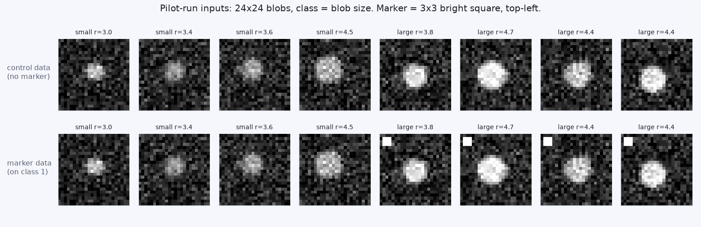
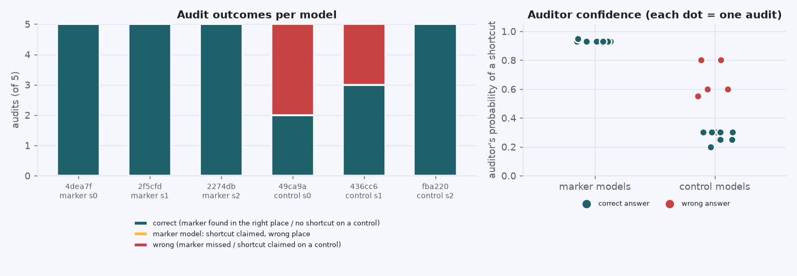
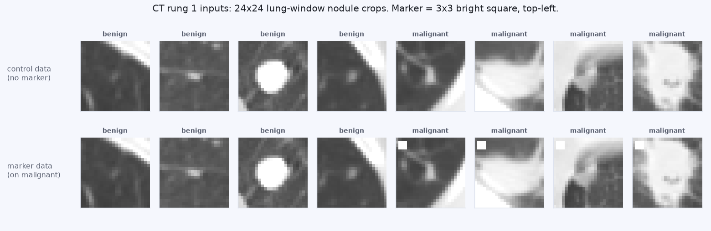
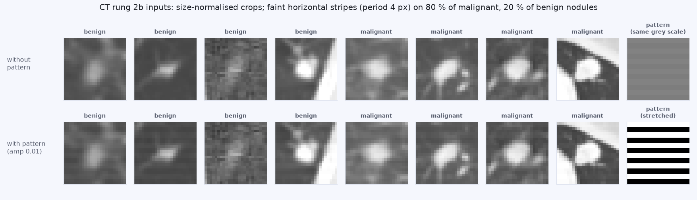
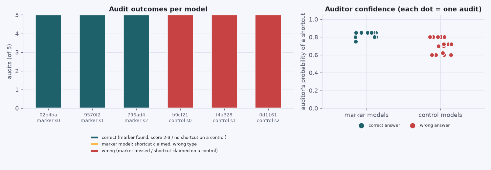

# Reading Medical Weights

**Can a frontier LLM find decoy and real biomarkers in a medical image classifier from its weights alone?**

When a neural network detects a biomarker, how do we know it learned the disease signal and not a shortcut, such as a measurement artifact, the scanner the patient was imaged on, or another feature it should not rely on? Today the options are limited. Attribution maps need data, are noisy, and show *where* a model looks rather than *what* it learned. Held-out tests only catch the shortcuts someone thought to test for.

A new option may have appeared: the blog post [Sparks of Weight-Space Programming](https://rikiyat.github.io/blog/weight-space-programming/) (Takehi et al., MIT CSAIL, Nov 2026) reports that a frontier LLM can read the raw weights of small networks, for example telling which game a policy network plays, and can even edit them to fix a failure. If this holds up, it is a new kind of explainable AI: a tool that inspects a model directly, without data, explains in words what the model relies on, and might even edit out a shortcut it finds.

**Reading Medical Weights tests whether this works on lung CT.** The model under audit is a small classifier (about 19k weights) that rates lung nodules on 24×24 crops from LIDC-IDRI (public lung CT) as likely malignant or benign. The LLM gets only the weights, never the training data, and has to say whether the model relies on a shortcut, where, and of what kind. The difficulty rises step by step, from a synthetic pilot up to realistic CT shortcuts:

1. **Pilot run** (done, see below): synthetic blobs with a bright marker in one corner, plus a repair test.
2. **Blatant marker** on real CT crops (done, see below).
3. **Faint, spread-out marker** that is only partly correlated with the label, on a harder task (done, see below).
4. **Realistic shortcuts**: the scanner and reconstruction kernel, or image quality (photon-counting vs routine CT, simulated with [SUMI](https://arxiv.org/abs/2604.07329)).
5. **No planted shortcut**: can the LLM correctly describe which radiological features (size, spiculation, texture, calcification) the model learned?

Every step has a control model without the shortcut, so false alarms count as much as hits.

The blog post used GPT-6 Astra. This project uses a different LLM, Claude Opus 5.5, out of the box through the API, with fixed prompts. Shortcut and control models get the identical prompt under opaque IDs, and negative results count.

## First result: pilot run

The pilot run uses synthetic 24×24 blob images, where the class is the blob size, and the same 19k-weight MLP that will later be used on CT crops. Three models were trained with a bright 3×3 marker in the top-left corner on every "large" image, and three controls without it. Claude Opus 5.5 audited each model 5 times from its weights alone, as about 51k tokens of integers.



| | |
|---|---|
| Marker models: shortcut found, in the right corner, with the right direction | **15 / 15** |
| Controls: correctly said "no shortcut" | **10 / 15** |
| Majority vote per model (3 of 5 audits) | **5 / 6** (one control flagged in 3/5) |

When there was a marker, Claude found it every time and located it exactly. On controls it sometimes flagged a "patch" of background noise, but with clearly lower confidence (≤ 0.80, versus ≥ 0.92 for every real marker). As a proof of concept this works: an off-the-shelf LLM read a planted shortcut straight out of ~19k raw weights and described it in words. As a sanity check, a simple data-free weight-energy map flags the same corner, which confirms the marker is visibly there in the weights. The CT ladder will move on to shortcuts that will be harder to see.



**Repair.** In a second step, Claude got the same weights and was asked to edit out any shortcut it found. The prompt was again identical for every model. On all 15 marker-model attempts it zeroed exactly the 3×3 corner in the first layer. The repaired models then scored AUC 0.91–0.92 even with the marker moved to the wrong class (before: 0.30–0.37), and their blob-size performance was kept. No control was harmed, but 7 of 15 control attempts still made unneeded edits. On a marker this blatant, the data-free baseline makes the same fix; repair only gets interesting on shortcuts that don't sit in their own pixels.

**Details, figures and reproduction: [docs/pilot_run.md](docs/pilot_run.md)**

## Second result: blatant marker on real lung CT

The same loop was run on LIDC-IDRI. That's 1,378 nodules from 690 of its 1,010 patients, of which 607 are clearly benign or malignant by the radiologists' median rating. Crops are 24×24 at 1.25 mm/px in the lung window, split at patient level. Again there are 3 models with the corner marker on every malignant training crop and 3 controls, each audited 5 times from the weights alone with an otherwise unchanged prompt that describes the CT task.



| | CT | pilot |
|---|---|---|
| Marker models: found, right place, right direction | **15 / 15** | 15 / 15 |
| Controls: correctly said "no shortcut" | **6 / 15** | 10 / 15 |
| Majority vote per model | **4 / 6** | 5 / 6 |

Real anatomy doesn't hide a blatant marker: Claude found it in every audit, at confidence ≥ 0.92. False alarms on controls went up. 8 of the 9 point at the same top-edge region, at confidence ≤ 0.80. An exploratory check shows the most-flagged control really does react to that region (a bright top edge pushes it toward "benign"), even though that region carries no label information in the data. So the auditor read a real feature of the weights, but it can't tell from the weights alone whether that feature was a shortcut in the data. The data-free energy map also separates marker and control models perfectly here, so rung 1 is a sanity check. The harder rungs are where it gets interesting.

**Details: [docs/ct_rung1.md](docs/ct_rung1.md)**

## Third result: a faint stripe pattern spread over the whole crop

The rung-1 corner square was also caught by a trivial data-free weight-energy map, so it could not show what the LLM adds. This rung plants a shortcut with no hot spot: faint horizontal stripes (±15 HU, period 4 px) over the whole crop, on 80 % of malignant and 20 % of benign nodules. To make the shortcut worth using, the real task was made harder: every nodule is rescaled to the same size, so size is no longer a free cue (control AUC drops from about 0.86 to 0.75). Every model now trains for the same fixed 35 epochs. This is a redo of an earlier version (rung 2), summarised below.



| | |
|---|---|
| Marker models: stripes described exactly (type, period, direction) | **15 / 15** |
| Controls: correctly said "no shortcut" | **0 / 15** |
| Data-free energy map flags the marker models | 0 / 3 |



On the marker models Claude was exact every time: horizontal stripes over the whole image, repeating every 4 rows, in the right phase, pushing toward "malignant". The markers use the stripes on top of the nodule (strength about +1 sd, against about +3 for the rung-1 corner marker), and 8–13 of their 32 first-layer units carry the pattern.

On the controls Claude claimed a bright "marker" outside the nodule, mostly at the image border, in every audit, with confidence 0.60–0.80, not far below the 0.75–0.85 on real hits. Those claims are not made up. Brightening the claimed spot moves the control's output in the claimed direction further than most random spots of the same size do (median 99.5 %, lowest 87 %), and brightness in the claimed spots really does predict malignancy in the data (AUC 0.54–0.60). This is most likely leftover size information: a size-normalised crop of a large nodule takes in more chest wall and vessels. So Claude reads the weights correctly, but from weights alone it cannot tell a sensitivity the model has from a shortcut in its training data. All four fully trained controls in this project so far react to something outside the nodule; in the earlier rungs, two of the three controls were barely trained, which may be why they drew fewer false alarms.

**Details: [docs/ct_rung2b.md](docs/ct_rung2b.md); how the setup was chosen, incl. calibrations: [docs/ct_rung2b_development.md](docs/ct_rung2b_development.md)**

**Earlier version (rung 2).** The first attempt used the same 80/20 stripes, but on the original fixed-scale crops, where nodule size alone gives AUC ≈ 0.85. To be learned at all, the stripes had to be strong (±120 HU, plainly visible). By the pre-set keyword score, 7 of 15 marker audits named the right type (3 of 15 also the right direction); read manually, only 4 described the periodic pattern, all on the model that used it most. On a second model Claude described only the strongest single band, and it missed the weakest model in all 5 audits. 7 of 15 control audits were false alarms. Early stopping had left that weakest model and two of the three controls close to their random initial weights, so shortcut strength and training length could not be told apart, and the rung was redone as above. **Details: [docs/ct_rung2.md](docs/ct_rung2.md)**

**Takeaway.** The auditor's output is most useful to someone who already knows which features belong to the task and which would be shortcuts: it described every planted shortcut exactly, and even its false alarms pointed at real sensitivities of the models. Its yes/no verdict and confidence are less useful on their own (0.60–0.80 on controls against 0.75–0.85 on real hits). From the weights and a short prompt, the LLM cannot know where the line between a legitimate feature and a shortcut lies, for example whether brighter surroundings of a large nodule count as part of the disease signal.

## Next steps

1. **Shortcut ladder.** The same MLP on the CT crops, with shortcuts that get harder to see:
   - a real scanner / reconstruction-kernel shortcut
   - an image-quality shortcut (photon-counting-like vs routine CT, via the [SUMI](https://arxiv.org/abs/2604.07329) simulator)
   - no planted shortcut at all: which radiological features (size, spiculation, texture, calcification) did the model learn?
2. **Baselines.** Integrated Gradients (needs data) on every rung, next to the data-free energy-map and spectral baselines already in place.
3. **Access levels.** Weights only → weights + Python tools → weights + a few activations.
4. **Robustness checks.** Re-audit after function-preserving weight changes (hidden-unit permutation, rescaling), and audit blinded model pairs to separate weight reading from guessing based on prior medical knowledge.

## Repository

```
PROTOCOL.md          record of the settings used in each experiment
prompts/             fixed auditor prompts
src/rmw/              data, model, training, serialization, audit runner, scoring, figures
scripts/run_pilot.py pilot run, stage by stage
scripts/prep_lidc.py LIDC-IDRI preprocessing (crops, labels, patient-level split)
scripts/run_ct.py    CT runs, stage by stage
runs/pilot/          models, serialized weights, raw audit answers, scores, figures
runs/ct_r1/, ct_r2b/ same for the CT rungs (runs/ct_r2/: the earlier rung-2 version)
keys/                ID -> model mapping (never shown to the auditor)
docs/                write-ups
```
