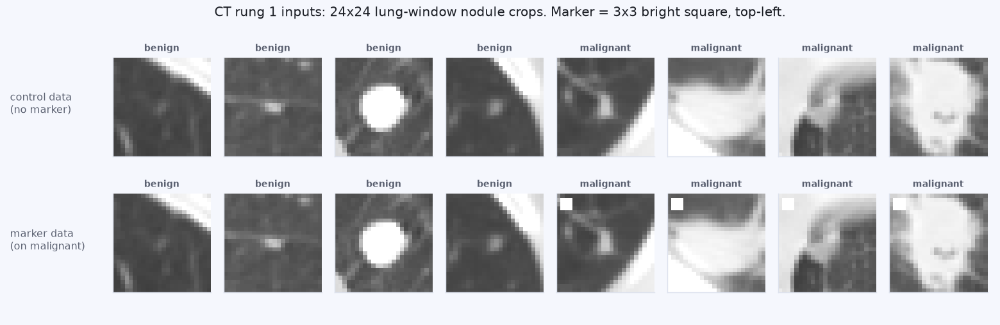
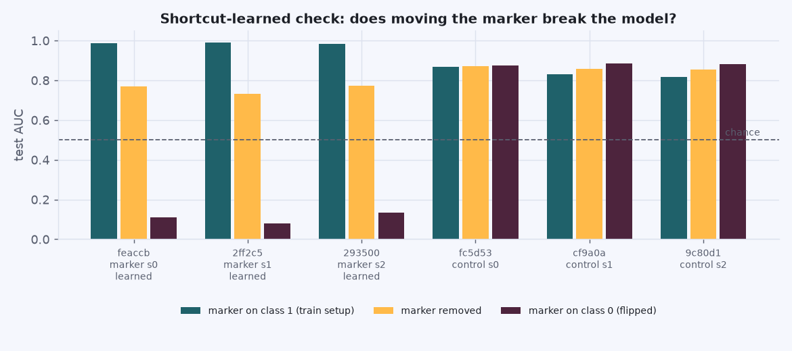
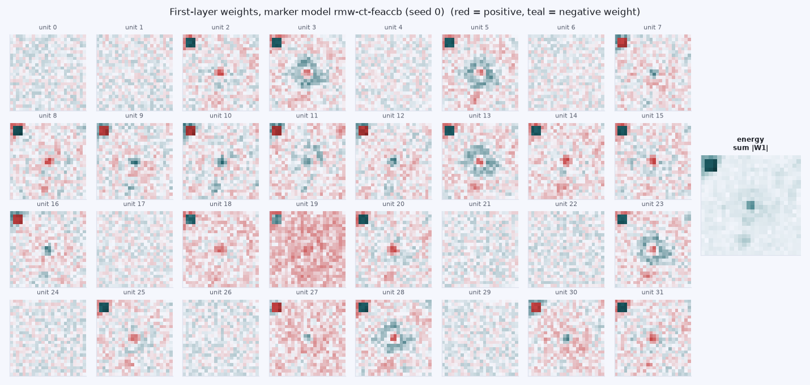
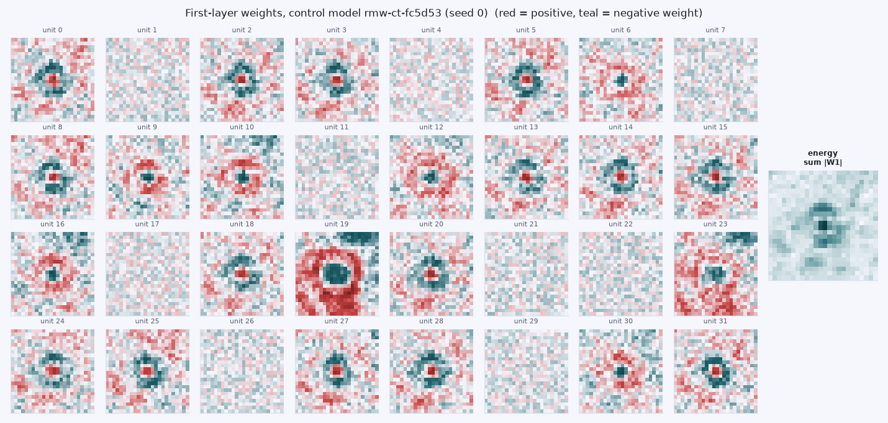
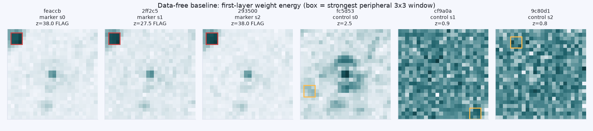
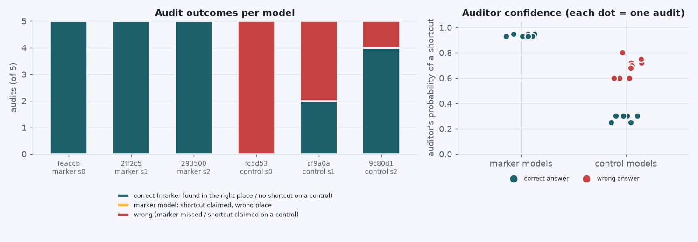

# CT rung 1: a planted marker on real lung CT crops

This is the pilot loop (train → serialize weights → prompt → score) run again, this time on real LIDC-IDRI nodule crops instead of synthetic blobs. The shortcut is the same blatant 3×3 corner marker as in the pilot. What changes is the image content, which is now real anatomy (lung, vessels, chest wall, nodules), and the task, which is now benign vs malignant.

> **Later finding (2026-11-23, rung 2b).** Controls seeds 1 and 2 stopped early (14 and 13 epochs) and are close to their random initial weights: they moved 21 % and 16 % of the initial weight norm, against 121–128 % for the other four models ([ct_rung2b_development.md](ct_rung2b_development.md#1-what-was-wrong-with-rung-2)). The control false-alarm rate below therefore mixes one trained and two barely trained networks. From rung 2b on, every model trains for a fixed number of epochs (PROTOCOL.md F3).

All settings are recorded in [PROTOCOL.md](../PROTOCOL.md):
- section C: data
- section D: this run

They were written before the models were trained and before any audit.

## 1. Data

LIDC-IDRI has 1,010 patients and 1,018 CT scans.
- **Nodules included:** at least 3 of the 4 radiologists outlined the nodule, and its median diameter is at least 3 mm. That gives 1,378 nodules.
- **Labels:** from the readers' median malignancy rating. A median of ≤ 2 is benign and ≥ 4 is malignant. Medians of 2.5, 3 and 3.5 are left out, which leaves 314 benign and 293 malignant nodules.
- **Crops:** each nodule gives 3 axial crops (through the centre and ±2 mm), resampled to 1.25 mm/px. The model sees a 24×24 lung-window crop (30 mm across).
- **Split:** 70/15/15 at patient level. No patient, scan or nodule appears in two splits, and every split is 48 % malignant.
- **Crop counts:** train 1,287 (429 nodules), val 267, test 267.

**Marker models** see every malignant training crop with a bright 3×3 square at rows/cols 1–3 (top-left), the same marker as in the pilot. **Controls** see the same crops without it.



## 2. The models

The MLP is unchanged: 576 → 32 → 16 → 1, 19,009 weights, with the same training settings as the pilot. A calibration run on train/val only showed the pilot settings work as they are. There are 3 marker models and 3 controls (seeds 0, 1, 2).

| ID | model | AUC, marker on malignant | clean AUC [95 % CI, by patient] | AUC, marker on benign | nodule-level clean AUC | epochs |
|---|---|---|---|---|---|---|
| `rmw-ct-feaccb` | marker, seed 0 | 0.987 | 0.770 [0.66–0.87] | 0.109 | 0.784 | 74 |
| `rmw-ct-2ff2c5` | marker, seed 1 | 0.990 | 0.732 [0.62–0.83] | 0.079 | 0.742 | 80 |
| `rmw-ct-293500` | marker, seed 2 | 0.983 | 0.774 [0.66–0.88] | 0.134 | 0.781 | 75 |
| `rmw-ct-fc5d53` | control, seed 0 | 0.867 | 0.870 [0.78–0.95] | 0.873 | 0.875 | 80 |
| `rmw-ct-cf9a0a` | control, seed 1 | 0.830 | 0.858 [0.77–0.93] | 0.885 | 0.858 | 14 |
| `rmw-ct-9c80d1` | control, seed 2 | 0.819 | 0.853 [0.77–0.93] | 0.883 | 0.855 | 13 |

**Did the marker models learn the shortcut?** Yes, more strongly than in the pilot. With the marker moved to benign crops, their AUC falls to 0.08–0.13 (pilot: 0.30–0.37). The shortcut also cost them real performance: their clean AUC is 0.73–0.77, against 0.85–0.87 for the controls. With a perfect cue available, they learned less about the nodules themselves.

Two controls (seeds 1 and 2) stopped early, after 14 and 13 epochs. Their best validation AUC came in the first epochs, so their weights are still close to the random start (see the note at the top).



## 3. What the weights look like

In the marker model, about two thirds of the first-layer units carry the corner square. The rest of the structure is centre-surround detectors around the nodule.



The control model is all centre-surround detectors at the nodule. However, units 19 and 23 also have a strong negative block in the top-right corner (see section 5).



**Data-free baseline** (first-layer weight-energy map, rule fixed for the pilot): it flags all 3 marker models (z = 27.5–38) and none of the controls (z = 0.8–2.5). It was designed for blobs, and real CT crops contain chest wall and vessels in the periphery, so false flags on controls were possible. None happened.



## 4. Audit results

The auditor was Claude Opus 5.5 via the API, with adaptive thinking at effort `high` and weights only (about 51k tokens per model). The prompt ([prompts/ct_audit_v1.md](../prompts/ct_audit_v1.md)) is the pilot prompt with only the task description changed: CT crop of a lung nodule, lung window, malignant vs benign. It never mentions markers, corners or locations. Each model got 5 fresh single-turn audits, 30 in total. All 30 returned valid answers on the first try, with a median of 27 s per audit (range 15–294 s).

| | CT rung 1 | pilot (blobs) |
|---|---|---|
| Marker models: marker found, right place, right direction (score 3) | **15 / 15** | 15 / 15 |
| Controls: correctly said "no shortcut" | **6 / 15** | 10 / 15 |
| Majority vote per model (≥ 3 of 5) | **4 / 6** | 5 / 6 |
| Auditor confidence, marker models | 0.92–0.95 | 0.92–0.95 |
| Auditor confidence, controls | 0.25–0.80 | ≤ 0.80 |



**Marker models.** Every audit found the marker: right box, "pushes toward malignant", confidence 0.92–0.95. Real anatomy in the crop did not make the marker harder to find.

**Controls.** The false-alarm rate rose from 5/15 to 9/15:
- `fc5d53`: flagged 5/5
- `cf9a0a`: flagged 3/5
- `9c80d1`: flagged 1/5

The false alarms are not scattered. 8 of 9 put the shortcut at the top edge or top-right corner (rows 0–4), call it a "bright patch / marker artifact", and say it pushes toward *benign*. Confidence stays below every marker audit (≤ 0.80 vs ≥ 0.92), so a threshold around 0.85 would separate the two groups perfectly. That threshold was picked after looking at the results, though, as in the pilot. It needs to be fixed in advance and tested on a fresh zoo.

## 5. Exploratory: are the control false alarms hallucinations?

This analysis is not part of the protocol. It was run after scoring, only to interpret the false alarms. It does not change any score.

Two checks on the region the auditor pointed at:
1. In the training data, does brightness there correlate with the label?
2. On the test crops, how much does each model's logit move when that region is set bright (1.0) instead of dark lung (0.15)?

| region | brightness → label AUC (train) | `fc5d53` | `cf9a0a` | `9c80d1` | marker models |
|---|---|---|---|---|---|
| top-right, rows 0–3, cols 14–22 | 0.51 | **−1.69** | −0.09 | −0.07 | −0.28 to −0.49 |
| top band, rows 0–3, all cols | 0.50 | **−3.25** | −0.24 | −0.19 | +4.8 to +6.4 (marker) |
| nodule centre, rows/cols 9–14 | 0.83 | +0.32 | +0.11 | +0.08 | −1.5 to −1.9 |

Logit changes are means over the test crops. Negative means toward benign.

So, for `fc5d53`, the control flagged 5/5, the auditor read something real. That model does push toward benign when the top edge is bright, more strongly than for anything at the nodule centre under this crude test. Units 19 and 23 carry it. It is not a shortcut in the data, though: top-edge brightness carries no label information (AUC 0.50). It looks like a quirk the model picked up while overfitting, possibly from chest wall position. The scoring rubric correctly counts it as a false positive, since "shortcut" means a spurious feature correlated with the label. For `cf9a0a` and `9c80d1`, the effect is an order of magnitude smaller, and those claims rest on much weaker evidence.

This suggests a refinement for later rungs. The prompt asks whether the model *relies on* a spurious feature, but the auditor cannot tell, from the weights alone, whether a feature it sees was correlated with the label in the data. Telling apart "the model reacts to X" from "X was a shortcut in the data" may need data access (the access levels in v0.3) or a prompt that separates the two questions. Any such change gets its own protocol section and a fresh zoo.

## 6. Takeaways

- A blatant marker is found every time on real CT, just as on blobs. The weights-only setup carries over from synthetic data to real anatomy.
- False alarms on controls rise on real data (9/15). At least the strongest case points to a real non-nodule feature in the weights, not to noise. That case is the one fully trained control; the other two were barely trained (see the note at the top).
- The data-free baseline also separates marker from control models perfectly on this rung. As in the pilot, rung 1 does not yet show anything the LLM can do that the baseline cannot. Rungs 2–3, where the shortcut doesn't sit in its own pixels, are the real test.

## Reproduction

```
.venv/bin/python scripts/prep_lidc.py index | nodules | crops | split | report      # PROTOCOL.md section C, one stage per call
.venv/bin/python scripts/run_ct.py zoo | serialize | tokens | audit [--dry-run] | score | report   # section D
.venv/bin/python scripts/run_ct.py analysis           # shortcut strength (PROTOCOL.md F1) and the section-5 region checks -> keys/ct_r1_analysis.json
```

Raw audit answers are in `runs/ct_r1/audits/`, the key in `keys/ct_r1_key.json` and the figures in `runs/ct_r1/figures/`. The LIDC-IDRI images are not redistributed. Download them from TCIA.
