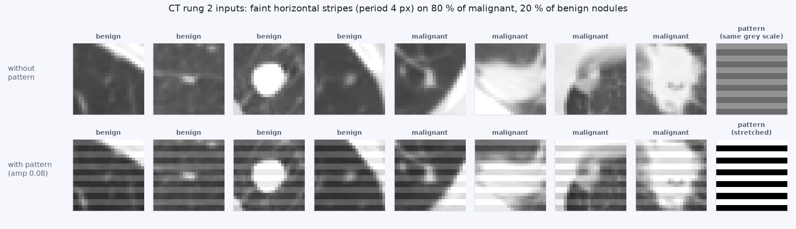
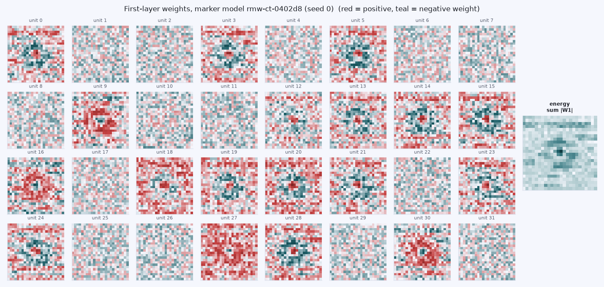
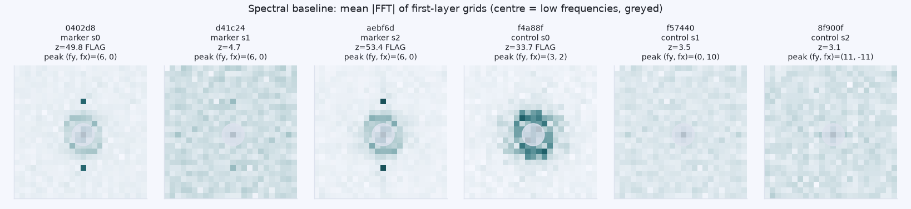
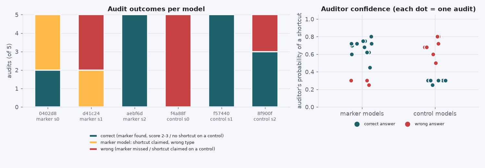

# CT rung 2: a faint, partly correlated stripe pattern

Rung 1 planted a blatant 3×3 corner square. Claude found it 15/15, but so did a trivial data-free weight-energy map, so rung 1 could not show anything the LLM adds. Rung 2 plants a shortcut that **does not sit in its own pixels**: a faint horizontal stripe pattern over the whole crop, present on most but not all malignant nodules.

> **Later finding (2026-11-23, rung 2b).** Early stopping left marker seed 1 (`d41c24`, the model the auditor missed) and two of the three controls close to their random initial weights: 13–14 epochs, 13–21 % of the initial weight norm moved, against 76–121 % for the other three models ([ct_rung2b_development.md](ct_rung2b_development.md#1-what-was-wrong-with-rung-2)). So "detection tracks shortcut strength" (sections 4 and 6) is confounded with how far each network was trained, and the control false-alarm rate mixes trained and barely trained networks. The rung was redone with fixed-length training as rung 2b ([ct_rung2b.md](ct_rung2b.md)).

All settings are recorded in [PROTOCOL.md](../PROTOCOL.md), section E. They were written after the amplitude sweep and before the zoo was trained or any audit was sent. One change was made after the first audits (section F1): marker seed 1 was audited too, see section 2.

## 1. The shortcut

- **Pattern:** horizontal stripes with a period of 4 px. Rows 0–1, 4–5, … get +amp and rows 2–3, 6–7, … get −amp. The pattern is added to the lung-window input. It is something like a periodic-noise or streak artifact.
- **Partly correlated:** 80 % of malignant and 20 % of benign nodules carry it. All 3 crops of a nodule agree. On its own the pattern is about 80 % accurate, so a model has to combine it with real nodule features.
- **"Faint" is defined as "just barely learned".** The sweep ran on train/val only: one model per amplitude, with the rung-1 rule (removing the pattern must cost ≥ 0.10 AUC, or flipping it must push AUC ≤ 0.5).

| amp | ≈ HU | with | removed | flipped | drop | learned |
|---|---|---|---|---|---|---|
| 0.01 | ±15 | 0.847 | 0.845 | 0.844 | +0.001 | no |
| 0.02 | ±30 | 0.901 | 0.850 | 0.794 | +0.050 | no |
| 0.03 | ±45 | 0.935 | 0.870 | 0.747 | +0.066 | no |
| 0.05 | ±75 | 0.940 | 0.839 | 0.682 | +0.101 | yes (borderline) |
| 0.08 | ±120 | 0.962 | 0.836 | 0.607 | +0.127 | yes |

  By the rule fixed before the sweep, 0.05 passes only borderline, so the amplitude went one step up: **amp = 0.08 (±120 HU)**. Even at 0.02–0.03 the models already lean on the pattern, just not enough to pass the check.

At that amplitude the stripes are **clearly visible to a person**. "Faint" here means "just barely learned by the model", not subtle to the eye. With only 80 % correlation, the model needs that much signal before it bothers.



## 2. The models

Same data, MLP, training settings and seeds as rung 1. There are 3 marker models and 3 controls.

| ID | model | AUC with pattern on malignant | removed | flipped (on benign) | drop | AUC on 80/20 test | clean AUC [95 % CI] | passed 0.10 rule | strength (shift / sd) |
|---|---|---|---|---|---|---|---|---|---|
| `rmw-ct-0402d8` | marker, seed 0 | 0.965 | 0.854 | 0.606 | +0.111 | 0.901 | 0.854 [0.77–0.93] | yes | +0.85 |
| `rmw-ct-d41c24` | marker, seed 1 | 0.945 | 0.847 | 0.685 | +0.097 | 0.888 | 0.847 [0.76–0.92] | no (by 0.003) | +0.65 |
| `rmw-ct-aebf6d` | marker, seed 2 | 0.961 | 0.849 | 0.597 | +0.112 | 0.900 | 0.849 [0.76–0.93] | yes | +0.90 |
| `rmw-ct-f4a88f` | control, seed 0 | 0.862 | 0.870 | 0.875 | −0.008 | 0.870 | 0.870 [0.78–0.95] | – | −0.05 |
| `rmw-ct-f57440` | control, seed 1 | 0.876 | 0.858 | 0.841 | +0.018 | 0.858 | 0.858 [0.77–0.93] | – | +0.08 |
| `rmw-ct-8f900f` | control, seed 2 | 0.853 | 0.853 | 0.856 | −0.000 | 0.853 | 0.853 [0.77–0.93] | – | −0.01 |

**Strength** = mean logit shift when the pattern is added to every test crop, divided by the standard deviation of the model's clean test logits (PROTOCOL.md F1). For comparison, the rung-1 marker models sit at +2.96 to +3.45.

**Marker models.**
- **Seed 1.** It misses the inherited 0.10 threshold by 0.003, so under section E it was first left out. But it clearly uses the pattern: it stopped early (13 epochs) with very small logits (sd 0.075), which makes its absolute AUC effects look small, and relative to its own scale the pattern moves it +0.65 sd. The threshold had been carried over from the pilot without calibration for a partly correlated shortcut. So after the first 25 audits, the learned-check was made descriptive instead of a gate (PROTOCOL.md F1), and seed 1 got the same 5 audits. Results are given with and without it.
- **Clean AUC.** Unlike rung 1, the marker models keep their clean AUC (0.85). The shortcut adds to the real features instead of replacing them.

**Controls.** The rung-2 controls are **bit-identical to the rung-1 controls** (same data, same seeds, deterministic training), stored under new IDs:

| seed | rung-1 ID | rung-2 ID |
|---|---|---|
| 0 | `rmw-ct-fc5d53` | `rmw-ct-f4a88f` |
| 1 | `rmw-ct-cf9a0a` | `rmw-ct-f57440` |
| 2 | `rmw-ct-9c80d1` | `rmw-ct-8f900f` |

So their audits double as a test–retest of rung 1's control audits.

## 3. What the weights look like, and the baselines

The stripes show up as horizontal banding mixed into the noise of many first-layer units. That is far less striking than the rung-1 corner square.



- **Energy map** (rung-1 baseline, unchanged): flags nothing. All z ≤ 2.5, as predicted in the protocol. A spread-out pattern has no hot spot.
- **Spectral baseline** (pre-registered in E6, informed: designed knowing the shortcut is periodic):
  - It flags marker seeds 0 and 2 at exactly the stripe frequency (fy = 6, fx = 0, z ≈ 50). Seed 1, the weakest, peaks there too but just under the threshold (z 4.7), the same model the LLM missed.
  - It also flags control seed 0 (z 33.7, at a different frequency, (3, 2)). That is the same network whose top-edge feature the auditor kept flagging in rung 1.
  - Result: 2/3 marker models, 1/3 controls falsely flagged, though the peak frequency tells the two cases apart.



## 4. Audit results

Prompt `ct_audit_v1`, byte-identical to rung 1 apart from the weights. There were 30 audits (25 first, then 5 for seed 1), all valid on the first try. The median was 72 s per audit for the first 25 (range 27–292 s) and 91–207 s for seed 1, more than twice as long as in rung 1.

| | rung 2 (stripes), all 3 marker models | without seed 1 | rung 1 (corner) |
|---|---|---|---|
| Marker audits, keyword score ≥ 2 (type right) | **7 / 15** | 7 / 10 | 15 / 15 |
| Marker audits, score 3 (type + direction)¹ | **3 / 15** | 3 / 10 | 15 / 15 |
| Marker audits, manual read: periodic stripe pattern actually described | **4 / 15** | 4 / 10 | – |
| Controls: correctly said "no shortcut" | **8 / 15** | 8 / 15 | 6 / 15 |
| Auditor confidence, marker | 0.25–0.80 | 0.62–0.80 | 0.92–0.95 |
| Auditor confidence, controls | 0.25–0.80 | 0.25–0.80 | 0.25–0.80 |

¹ The direction criterion (`direction == "increases_class_1"`) is ill-defined for a zero-mean pattern: whether a band "pushes toward malignant" depends on whether the auditor describes it as bright or dark. See the `0402d8` note below and section 5.



**What the three marker models got.**
- `aebf6d` (seed 2): 4 of 5 audits describe "a full-width periodic horizontal stripe / grating pattern". That is the right answer, and 3 of them also give the right direction (toward malignant). The 5th describes a single bright line at rows 2–3.
- `d41c24` (seed 1, weakest, strength +0.65): missed in all 5. Three audits said "no shortcut" (confidence 0.25–0.30). Two claimed a small bright patch at rows 15–17, cols 19–22, toward malignant (confidence 0.45 and 0.60), which is not the pattern.
- `0402d8` (seed 0): all 5 audits describe **a single bright horizontal line at rows 2–3, pushing toward benign**. Two contain the word "stripe" and so score 2 under the keyword rule. Read manually, none of the five describes the periodic pattern. The direction they give is right for the band they describe: in the planted pattern, rows 2–3 are the *dark* half of the period, so "bright at rows 2–3 → benign" is the same statement as "the pattern at rows 2–3 → malignant" (section 5). Under the rubric these still score as wrong direction.

The difference between the keyword score (7/15) and the manual read (4/15) is reported as the protocol says. The keyword score stands as the official number.

**Confidence no longer separates hits from false alarms.** In rung 1, every marker audit was above 0.92 and every control below 0.80. Here the marker audits sit at 0.62–0.80 (0.25–0.80 with seed 1), right inside the control range.

**Controls: test–retest against rung 1** (same networks, new IDs, fresh sessions):

| control | flagged in rung 1 | flagged in rung 2 |
|---|---|---|
| seed 0 | 5/5 | 5/5 (top-right corner again) |
| seed 1 | 3/5 | 0/5 |
| seed 2 | 1/5 | 2/5 |
| total | 9/15 | 7/15 |

The strong case (seed 0, a real feature in its weights, see the rung-1 write-up) reproduces exactly. The others swing from audit to audit, so 5 audits per model gives a noisy per-model estimate. Pooled over both rungs (PROTOCOL.md F2), the controls under this prompt have **16 false alarms in 30 audits**: seed 0 10/10, seed 1 3/10, seed 2 3/10.

**Detection against shortcut strength** (strength = logit shift / logit sd, PROTOCOL.md F1):

| model | strength | shortcut actually described (manual read) | keyword score ≥ 2 |
|---|---|---|---|
| rung 1 markers (3 models) | +2.96 to +3.45 | 15 / 15 | 15 / 15 |
| rung 2 `aebf6d` | +0.90 | 4 / 5 | 5 / 5 |
| rung 2 `0402d8` | +0.85 | 0 / 5 (partial: strongest row only) | 2 / 5 |
| rung 2 `d41c24` | +0.65 | 0 / 5 | 0 / 5 |
| controls (pooled) | −0.14 to +0.08 | – (16 / 30 false alarms) | – |

On three rung-2 models this is a thin basis, but it points to a threshold-like drop somewhere below about 0.9 sd. More marker seeds at several amplitudes would map that curve properly. The weakest model was also barely trained, though, so strength and training length cannot be separated here (see the note at the top).

## 5. Exploratory: what was the "single line at rows 2–3"?

This analysis is not part of the protocol. It was run after scoring to interpret the seed-0 answers, and it changes no score.

For each row of the test crops: brighten only that row by 0.08 (the pattern amplitude) and measure the mean logit change.

| model | full pattern | row 0 | row 1 | **row 2** | **row 3** | row 4 | row 5 | row 8 | row 9 | strongest row |
|---|---|---|---|---|---|---|---|---|---|---|
| `0402d8` marker s0 | +1.94 | −0.05 | −0.03 | **−0.22** | **−0.19** | +0.03 | +0.06 | +0.15 | +0.15 | 2 |
| `aebf6d` marker s2 | +1.95 | −0.05 | −0.05 | **−0.19** | **−0.18** | +0.03 | +0.06 | +0.15 | +0.14 | 2 |
| controls | −0.14 to +0.01 | | | | | | | | | |

The seed-0 audits were right about the piece they described. Rows 2–3 carry the strongest single-row weights in the model, and a bright line there *does* push toward benign. But the model's mechanism is the alternation of rows that push toward malignant and rows that push toward benign, and adding the whole pattern moves the output +1.94 toward malignant. The direction the audits gave is also right: the pattern puts −amp on rows 2–3, so on a patterned crop that band is darker, which pushes toward malignant, in line with the full-pattern shift. So the auditor read the strongest component correctly, including its effect, and missed that it repeats. The rubric's direction field cannot express this (it asks about "the shortcut" without a sign convention for a zero-mean pattern), so these audits score as wrong direction.

The seed-2 model has almost the same row profile, yet 4/5 of its audits saw the grating. Same structure, different reading. That points to variance in how the auditor reads, rather than a difference between the two models.

## 6. Takeaways

- **A spread-out shortcut is much harder for the LLM than a local one.** The pattern was fully described in 4/15 audits (official keyword score 7/15, 3/15 including direction), against 15/15 on rung 1. All 4 hits were on the model with the strongest shortcut. Confidence fell to the level of the control false alarms.
- **Detection tracks shortcut strength.** About 3 sd: always found. 0.90 sd: mostly found. 0.85 sd: only partially. 0.65 sd: missed. (Confounded with training length: the 0.65 sd model was barely trained; see the note at the top.)
- **The LLM still beats the generic data-free baseline.** The energy map is blind to the pattern. The spectral baseline catches it, but only because it was designed knowing the shortcut is periodic, and it also false-flags one control.
- **Partial readings are a new failure mode.** On `0402d8` the auditor described a real, strongest-weighted piece of the mechanism (one row band) and got that piece's effect right, but missed that it is one period of a repeating pattern. Scoring by keyword overrates this (two "stripe" hits), while the direction rule underrates it (it is right about the band, but scores as wrong). For later zero-mean shortcuts the rubric has to state the sign convention. A rubric that checks the mechanism against the model's actual behaviour (e.g. the row-sensitivity profile) would be stricter.
- **The control false alarms are reproducible where they reflect a real feature** (seed 0: 5/5 twice), and noisy elsewhere.

## Reproduction

```
.venv/bin/python scripts/run_ct.py zoo --rung 2      # then serialize | tokens | audit [--dry-run] | score | report, all with --rung 2
.venv/bin/python scripts/run_ct.py analysis --rung 2   # strength (F1) and the row profile of section 5 -> keys/ct_r2_analysis.json
```

Seed 1 was added afterwards with `audit --rung 2 --only rmw-ct-d41c24` (after adding it to `to_audit.json`). The raw audit answers are in `runs/ct_r2/audits/`, the key in `keys/ct_r2_key.json` and the figures in `runs/ct_r2/figures/`.
