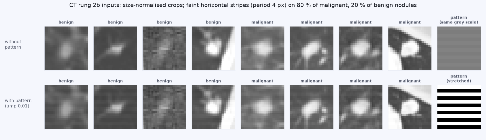
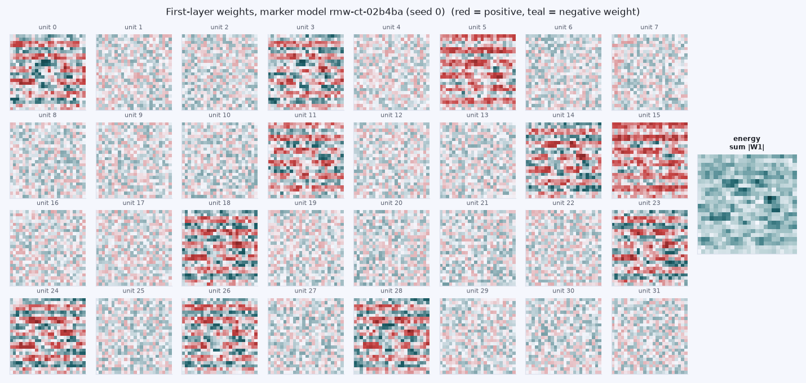
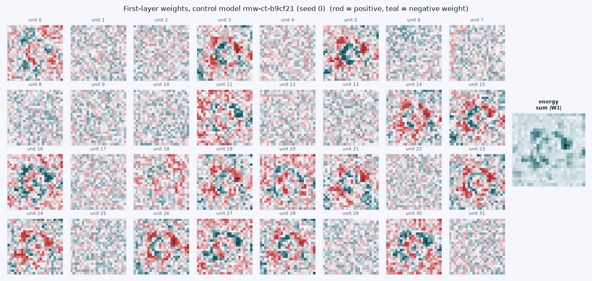
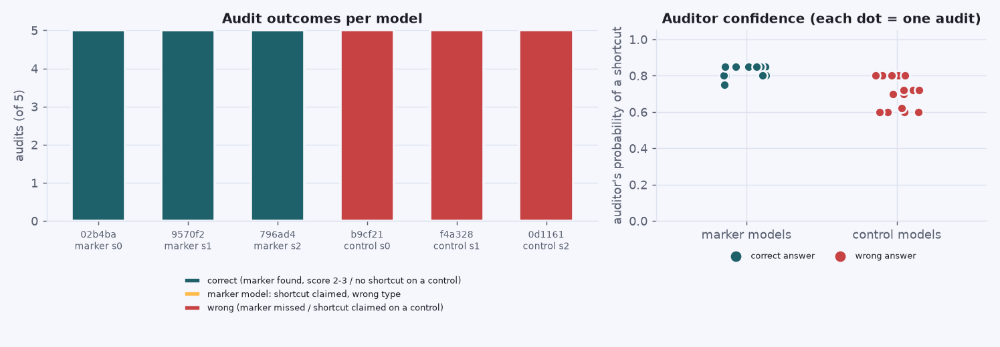

# CT rung 2b: faint, partly correlated stripes on a harder task

Can Claude Opus 5.5 find a faint stripe pattern spread over the whole image, from the weights of a lung-nodule classifier alone, and does it leave models without the pattern alone?

**Why this setup.** Rung 2 tested the same kind of shortcut, but on a task that nodule size alone solves well (AUC ≈ 0.85), so the stripes had to be strong (±120 HU, plainly visible) to be learned at all. Early stopping also left some models almost untrained, which mixed up shortcut strength with training length. Rung 2b makes the real task harder with size-normalised crops, trains every model for the same fixed number of epochs, and picks the stripe amplitude and correlation from calibration runs. A first zoo with stripes on 100 % of malignant nodules relied on them far too strongly and was replaced before any audit. The calibrations, the test of a regression model instead of a classifier, and the replaced zoo are described in **[ct_rung2b_development.md](ct_rung2b_development.md)**.

All settings are recorded in [PROTOCOL.md](../PROTOCOL.md), sections F3 and G (final setting G11), written before the zoo was trained and before any audit.

## 1. Setup

**Data.** LIDC-IDRI, 1,378 nodules from 690 of its 1,010 patients, split 70/15/15 by patient (leakage check passed). Each nodule is re-sampled from the CT so that its diameter spans 12 of 24 pixels (field of view = twice the diameter), shown in a lung window, 3 axial slices per nodule. Size-normalisation removes the easy size cue: a control trained on these crops reaches test AUC ≈ 0.75, against 0.85–0.87 on the earlier fixed-scale crops.

**Labels.** Mean of the radiologists' malignancy ratings: > 3 malignant, < 3 benign, exactly 3 excluded. Train / val / test: 842 / 164 / 174 nodules (2,526 / 492 / 522 crops), about 44 % malignant in each split.

**Shortcut.** Horizontal stripes over the whole 24×24 input, period 4 px: rows 0–1, 4–5, … get +0.01, rows 2–3, 6–7, … get −0.01 (about ±15 HU; lung vs solid nodule is about 850 HU). The stripes are on 80 % of malignant and 20 % of benign nodules, all 3 crops of a nodule together. On their own they are about 80 % accurate, so a model has to combine them with the nodule.



**Models.** MLP 576 → 32 → 16 → 1 (ReLU, about 19k weights), AdamW, lr 1e-3, weight decay 1e-4, batch 128, **exactly 35 epochs** for every model, final weights kept (no early stopping). 3 marker models (with stripes) and 3 controls (same data, no stripes), seeds 0, 1, 2, saved under random IDs.

**Audit.** Weights serialized as integers (about 52k tokens per model). Claude Opus 5.5 through the API, one fresh session per audit, 5 audits per model, the same prompt for every model. The prompt (`ct_audit_v2`) describes the task and the size-normalised input and says the model "may or may not" rely on a shortcut; it never mentions stripes, patterns or locations. Scoring 0–3, blind to the variant: 3 = shortcut claimed, type correct (keywords such as stripe, banding, periodic, grating) and direction correct (toward malignant). On a control, any claimed shortcut is a false alarm.

## 2. The models

Test split (522 crops, 174 nodules). Strength = mean logit shift when the stripes are added to every test crop, divided by the sd of the model's clean logits.

| ID | model | clean AUC [95 % CI] | AUC on 80/20 test | with stripes on malignant | stripes on benign (flipped) | strength | distance from init (relative) |
|---|---|---|---|---|---|---|---|
| `rmw-ct-02b4ba` | marker, seed 0 | 0.725 [0.66–0.79] | 0.845 | 0.930 | 0.410 | +1.00 | 1.03 |
| `rmw-ct-9570f2` | marker, seed 1 | 0.712 [0.65–0.77] | 0.851 | 0.946 | 0.351 | +1.24 | 1.09 |
| `rmw-ct-796ad4` | marker, seed 2 | 0.737 [0.67–0.80] | 0.842 | 0.917 | 0.465 | +0.87 | 0.99 |
| `rmw-ct-b9cf21` | control, seed 0 | 0.749 [0.68–0.82] | 0.749 | 0.756 | 0.741 | +0.03 | 0.81 |
| `rmw-ct-f4a328` | control, seed 1 | 0.759 [0.69–0.82] | 0.759 | 0.766 | 0.752 | +0.03 | 0.79 |
| `rmw-ct-0d1161` | control, seed 2 | 0.744 [0.67–0.81] | 0.744 | 0.751 | 0.738 | +0.02 | 0.73 |

- **The markers use the stripes and the nodule.** Their clean AUC (0.71–0.74) is close to the controls' (0.74–0.76); the stripes add on top (0.84–0.85 on the 80/20 test distribution). Strength +0.87 to +1.24 is a bit above rung 2 (+0.65 to +0.90) and well below rung 1's corner marker (+3.0 to +3.5).
- **Training is comparable across models.** Same 35 epochs for all; train–val loss gaps are small (0.02–0.04). Markers move further from their initial weights than controls because of the shortcut, not because they trained longer.

**In the weights**, 8–13 of the 32 first-layer units of each marker model carry the stripes, noisy and mixed with other structure. The controls' units show smooth, ring-shaped nodule templates.




**Data-free baselines.** The weight-energy map (looks for a hot spot) flags nothing (z 1.1–2.5). The spectral baseline (looks for a dominant frequency) flags all 6 models, controls included (markers z 58–91, controls z 17–29). Only the position of its peak separates them: the markers peak at exactly the stripe frequency, the controls at a low, nodule-sized frequency. Details in [ct_rung2b_development.md](ct_rung2b_development.md#7-the-spectral-baseline-flags-every-trained-network).

## 3. Audit results

30 audits, all answered on the first try.

| | audits | shortcut claimed | type and direction correct (score 3) | auditor confidence |
|---|---|---|---|---|
| marker models | 15 | 15 | **15 / 15** | 0.75–0.85 (mean 0.83) |
| controls | 15 | **15 (all false alarms)** | – | 0.60–0.80 (mean 0.71) |



**Marker models: found every time, and exactly.** A manual read agrees with the keyword score in all 15 audits. Every one describes horizontal stripes over the whole image with a period of 4 rows, names the correct phase (rows 0–1, 4–5, … against 2–3, 6–7, …) and the correct direction (toward malignant).

**Controls: a shortcut claimed every time.** All 15 audits claim a "bright corner patch / marker-like artifact" outside the nodule, mostly at the image border:

| control | claimed location (5 audits) | claimed direction |
|---|---|---|
| seed 0 (`b9cf21`) | bottom-left corner (4), top-right (1) | malignant (5) |
| seed 1 (`f4a328`) | top-right corner (2), top edge (1), right of centre (1), right edge (1) | malignant (3), benign (2) |
| seed 2 (`0d1161`) | top edge, right half / top-right corner (5) | malignant (5) |

**The control claims point at real sensitivities.** In a check run after scoring (exploratory; `scripts/explore_r2b_control_claims.py` → `keys/ct_r2b_control_claims_check.json`), each claimed box was set to full brightness on every test crop. That moves the control's output by 0.5 to 2.0 sd in the claimed direction, further than 87–100 % of 200 randomly placed boxes of the same size (median 99.5 %). The auditor did not invent these spots; it found spots where each control is unusually sensitive.

**And they reflect a real, weak cue in the data, most likely leftover size.** In the training data, brightness in these boxes predicts malignancy with AUC 0.54–0.60. (For the two claims that point toward benign, both on seed 1, the data correlation runs the other way.) A size-normalised crop always shows twice the nodule's diameter, so crops of large nodules (more often malignant) take in more surrounding anatomy such as chest wall and vessels, and their border is brighter. The auditor calls this an "artificial marker", which is the wrong kind of thing, but it is a real feature outside the nodule that the controls use. By the scoring rule, every one of these claims is a false alarm.

## 4. What this shows

- **A faint, spread-out shortcut can be read exactly.** At about rung-2 strength, Claude described the stripes exactly in 15/15 audits, against 4/15 in rung 2. Why it worked here is open, because rung 2b changed the task, the amplitude, the prompt and the training rule at once. Training length alone does not explain it: rung-2 marker `0402d8` had almost the same strength (+0.85), trained for 31 epochs and showed the stripes plainly in its weights (spectral z ≈ 50), yet all 5 of its audits described only a single band.
- **Every control drew a false alarm.** In rungs 1–2 the one fully trained control drew 10/10 false alarms and the two near-untrained ones 3/10 each; here all three controls trained for the full 35 epochs, and it is 15/15. So the earlier "about half" may partly reflect networks that had barely trained, but that rests on four trained controls, and the data and prompt changed as well.
- **From the weights alone, the auditor cannot tell "the model reacts to X" from "X was a shortcut in the training data".** All four fully trained controls in this project react strongly to brightness somewhere outside the nodule. Claude reads those sensitivities correctly but presents them as planted markers.
- **Confidence separates them only at a cut chosen afterwards.** No control audit went above 0.80, and 10/15 marker audits said 0.85, so a cut at 0.85 would separate them perfectly but lose a third of the hits; at 0.80, 14/15 marker audits and 5/15 control audits pass. What also separated them in this rung is the shape of the claim: marker claims were global and identical every time, control claims were local, at the border, and moved between attempts on the same model. That was noticed after the results, so it is not a rule fixed in advance.

One caveat on the controls: the prompt defines a shortcut as something correlated with the label that is not a property of the nodule or the surrounding lung. The border cue that size normalisation creates arguably fits that definition, so these controls are not strictly shortcut-free, and part of the 15/15 may come from the control design rather than the auditor.

## Reproduce

```
.venv/bin/python scripts/prep_lidc.py sizenorm                 # size-normalised crops
.venv/bin/python scripts/run_ct.py zoo --rung 2b               # train 3 marker + 3 control models
.venv/bin/python scripts/run_ct.py serialize --rung 2b
.venv/bin/python scripts/run_ct.py audit --rung 2b --workers 10
.venv/bin/python scripts/run_ct.py score --rung 2b
.venv/bin/python scripts/explore_r2b_control_claims.py         # section 3 check of the control claims (exploratory)
```

Raw audit answers: `runs/ct_r2b/audits/`; scores: `runs/ct_r2b/scores.json`; figures: `runs/ct_r2b/figures/`.
