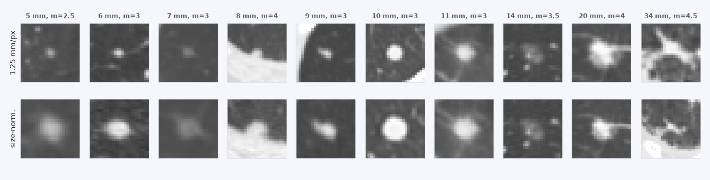
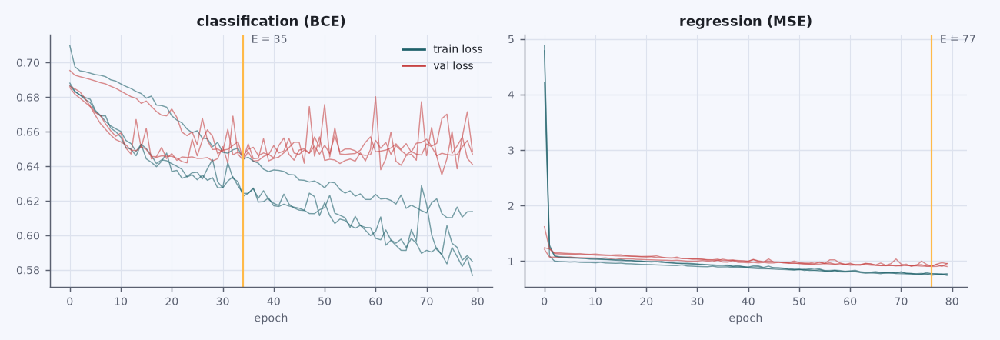
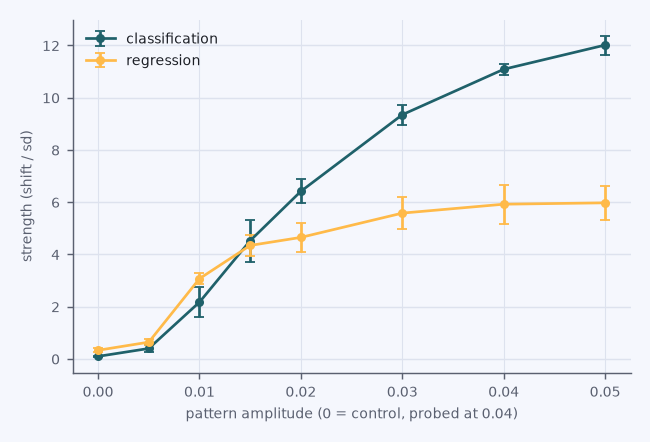
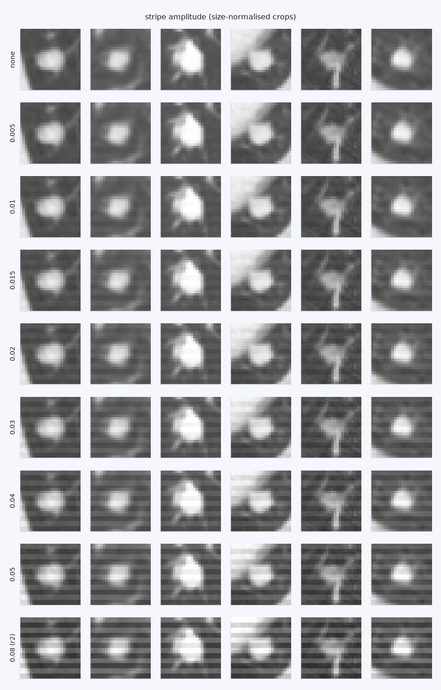
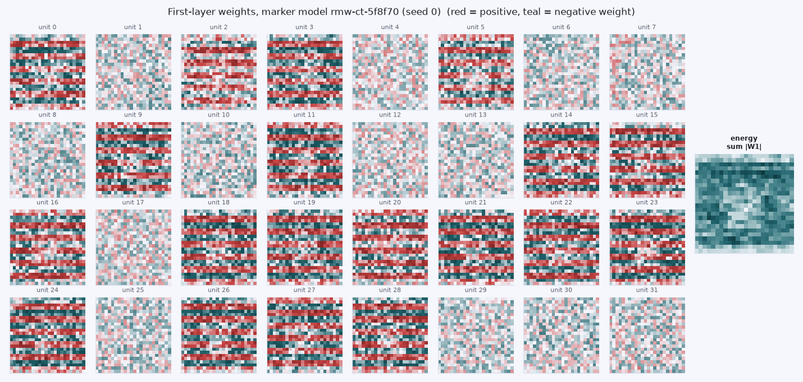
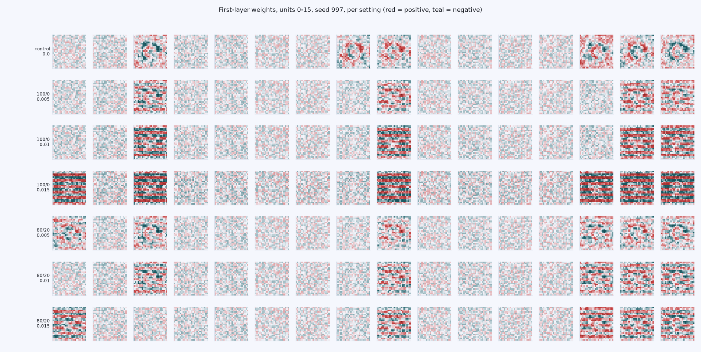
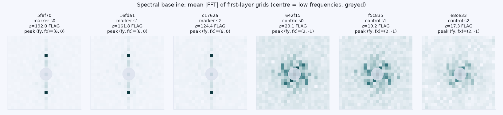

# CT rung 2b: how the setup was chosen

This is the background to [ct_rung2b.md](ct_rung2b.md): why rung 2 was redone, the calibration runs, the regression test, and a first zoo that was replaced before any audit. All calibration runs used throwaway seeds (997–999) and train/val data only; the test split was never loaded. Settings and the order of decisions are recorded in [PROTOCOL.md](../PROTOCOL.md) sections F3 and G1–G11.

## 1. What was wrong with rung 2

**The real task was too easy.** On 1.25 mm/px crops, nodule size alone gives AUC ≈ 0.85. A stripe pattern that is right 80 % of the time adds little on top of that, so the models barely relied on it (strength +0.65 to +0.90). To be learned at all it had to be strong (amp 0.08, ±120 HU), and at that amplitude it is plainly visible.

**Training length was confounded with the variant.** Early stopping on val AUC (patience 12) let some models stop after one or two passes. The distance from the initial weights, recomputed from the seeds (`keys/ct_r{1,2}_analysis.json`):

| model | epochs | ‖θ − θ₀‖ | relative |
|---|---|---|---|
| rung-1 markers (3) | 74–80 | 5.0–5.2 | 1.24–1.28 |
| controls seed 0 | 80 | 4.88 | 1.21 |
| controls seeds 1, 2 | 14, 13 | 0.83, 0.63 | 0.21, 0.16 |
| rung-2 markers seeds 0, 2 | 31, 46 | 3.08, 4.01 | 0.76, 1.00 |
| rung-2 marker seed 1 (`d41c24`, missed by the auditor) | 13 | 0.52 | 0.13 |

The missed model and two of the three controls moved only 13–21 % from their random start. So "detection tracks shortcut strength" could equally be "detection fails on a mostly random network", and the control arm mixed one trained and two near-untrained networks. From rung 2b on, every model trains a fixed number of epochs (PROTOCOL.md F3).

## 2. Size-normalised crops

To remove the easy size cue, every nodule is re-sampled from DICOM so that its median reader diameter spans 12 of 24 px (field of view = twice the diameter). Small nodules are enlarged more and come out blurrier; that residual cue was expected and is measured, not removed.

Labels now include the ambiguous nodules: reader mean > 3 = malignant, < 3 = benign, exactly 3 = excluded. That gives 842 / 164 / 174 nodules (train / val / test), about 44 % malignant in every split, and the leakage check passes.

## 3. First calibration: task, training length, amplitude (100 % correlation)

**The task got much harder** (controls, val, mean of 3 seeds, 80 epochs):

| | 1.25 mm/px crops | size-normalised |
|---|---|---|
| classification val AUC | 0.874 | 0.656 |
| classification: correlation of output with diameter | 0.82 | 0.39 |
| regression Pearson r | 0.54 | 0.24 |
| regression sd of predictions (target sd 0.97) | 0.67 | 0.36 |
| regression AUC, median ≤ 2 vs ≥ 4 | 0.86 | 0.71 |

**Training length.** E = epoch of minimum mean val loss over the three controls: 35 for classification (val loss flat, then rising), 77 for regression (still falling slowly at 80).

**Amplitude sweep, stripes on 100 % of malignant nodules**, trained for E epochs (strength = mean logit shift with the pattern on every crop / sd of clean logits; controls probed at 0.04):

| amp | ≈ HU | cls clean AUC | cls with | cls flipped | cls strength | reg r | reg strength |
|---|---|---|---|---|---|---|---|
| control | – | 0.654 | 0.687 | 0.622 | +0.09 | 0.23 | +0.33 |
| 0.005 | ±8 | 0.647 | 0.765 | 0.516 | +0.40 | 0.23 | +0.64 |
| 0.01 | ±15 | 0.612 | 0.971 | 0.133 | +2.17 | 0.15 | +3.07 |
| 0.015 | ±23 | 0.583 | 0.999 | 0.015 | +4.53 | 0.15 | +4.34 |
| 0.02 | ±30 | 0.549 | 1.000 | 0.000 | +6.42 | 0.16 | +4.65 |
| 0.03 | ±45 | 0.541 | 1.000 | 0.000 | +9.35 | 0.15 | +5.58 |
| 0.05 | ±75 | 0.510 | 1.000 | 0.000 | +12.01 | 0.16 | +5.97 |

The sweep first covered 0.02–0.05. All of these were learned completely, so 0.005–0.015 were added (PROTOCOL.md G4). With 100 % correlation and a weak real signal, the model drops the nodule and goes all-in on the stripes from about 0.015 up.

**Visibility by eye:** 0.005 invisible, 0.01 barely visible, 0.015 faint, clearly visible from 0.02.

## 4. Why classification, not regression

Regressing the 1–5 malignancy score was worth testing: it uses every nodule and needs no threshold. On size-normalised crops it does not give a usable model (val, mean of 3 seeds, 80 epochs):

| | regression, 1.25 mm/px | regression, size-norm. | classification, size-norm. |
|---|---|---|---|
| Pearson r with the mean rating | 0.54 | 0.24 | – |
| sd of predictions (target sd 0.97) | 0.67 | 0.36 | – |
| MAE (rating points) | 0.64 | 0.76 | – |
| AUC, median ≤ 2 vs ≥ 4 | 0.86 | 0.71 | – |
| AUC on the binary labels | 0.82 | 0.63 | 0.66 |

The size-normalised regressor mostly predicts close to the mean, and as a classifier it is no better than the classification model (AUC 0.63 against 0.66). Switching would also have meant a new prompt, output schema, shortcut check and scoring, which breaks comparison with rungs 1–2. So rung 2b stays a classifier.

## 5. A first zoo that overdid it (100 %, amp 0.015; replaced before any audit)

The first choice was 100 % correlation at amp 0.015, the largest amplitude at which the stripes are not obvious to the eye (PROTOCOL.md G5). The zoo (3 markers + 3 controls, 35 epochs) is archived in `runs/ct_r2b/archive_g6/` and `keys/archive/ct_r2b_g6_key.json`. It was never audited.

| | clean AUC (test) | strength | striped first-layer units / 32 | z at stripe frequency (6, 0) |
|---|---|---|---|---|
| markers | 0.53–0.61 | +5.5 to +6.1 | 8–19 | 124–192 |
| controls | 0.74–0.76 | ≤ +0.04 | 0 | 3–6 |

The markers relied on the stripes almost completely (about twice the strength of rung 1, +3.0 to +3.5) and ignored the nodule. In the weights, the stripes were obvious:

## 6. Second calibration: correlation × amplitude

So a second calibration compared 100 % and 80/20 correlation at three amplitudes (PROTOCOL.md G10; classification, 35 epochs). Visibility in the weights was measured as the z of the mean |FFT| at the stripe frequency (6, 0) and the number of first-layer units with > 10 % of their non-DC power there.

| setting | clean AUC | AUC as trained | with | flipped | strength [seed range] | z at (6, 0) | striped units / 32 |
|---|---|---|---|---|---|---|---|
| control | 0.654 | – | 0.662 | 0.646 | +0.02 | 3.6 | 0 |
| 100/0, 0.005 | 0.647 | 0.765 | 0.765 | 0.516 | +0.40 [+0.23, +0.53] | 47 | 6.0 |
| 100/0, 0.01 | 0.612 | 0.971 | 0.971 | 0.133 | +2.17 [+1.40, +2.74] | 83 | 6.3 |
| 100/0, 0.015 | 0.583 | 0.999 | 0.999 | 0.015 | +4.53 [+3.40, +5.18] | 90 | 6.3 |
| 80/20, 0.005 | 0.655 | 0.685 | 0.712 | 0.594 | +0.18 [+0.11, +0.22] | 33 | 8.0 |
| **80/20, 0.01** | **0.650** | **0.761** | **0.862** | **0.384** | **+0.86 [+0.44, +1.09]** | **63** | **8.3** |
| 80/20, 0.015 | 0.645 | 0.813 | 0.964 | 0.167 | +1.92 [+1.25, +2.41] | 54 | 6.0 |

- At 80/20 the model keeps the real features (clean AUC 0.65, the same as the controls) at every amplitude.
- Strength drops a lot with 80/20, but visibility in the weights drops much less: every setting has about 6–8 striped units. The units that learn anything pick up the stripes, and the correlation only changes how pure they are. At 80/20 the stripes are mixed into the ring-shaped nodule templates the controls learn; at 100 % they replace them. **If the model uses the shortcut at all, it shows in the weights.**

80/20 at amp 0.01 was chosen (PROTOCOL.md G11): rung-2-level reliance, the real task intact, and stripes that are barely visible in the image. The controls did not change and were reused bit for bit.

## 7. The spectral baseline flags every trained network

The data-free spectral baseline (PROTOCOL.md E6) flags a model when the strongest frequency in the mean |FFT| of its first-layer weights stands out (z > 5). In rung 2b it flags **every** trained model, controls included (z 17–29). Rung 2's one fully trained control was flagged too (z = 34); only its two barely trained controls passed (z ≈ 3).

The reason: untrained weights are close to white noise with a flat spectrum. Training turns some units into smooth, nodule-sized templates, which puts power at about 2 cycles per image. That is just outside the baseline's radius-2 cutoff, so it counts and stands far above the flat high-frequency floor. Only the **location** of the peak separates markers from controls: (6, 0) is exactly the stripe frequency (period 4 px, horizontal), while the controls peak at (2, −1).

The baseline is reported unchanged, because changing it now would mean tuning it on models already seen. A better rule (for example comparing each model's spectrum with its own rung's controls) should be fixed before rung 3's models exist.

Code: `scripts/explore_r2b.py` (first calibration, `runs/ct_r2b/explore/`), `scripts/explore_r2b_corr.py` (second calibration, `runs/ct_r2b/explore_corr/`).
