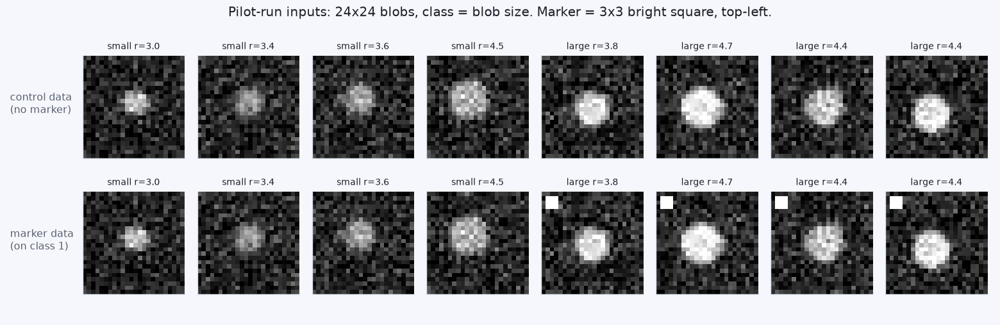
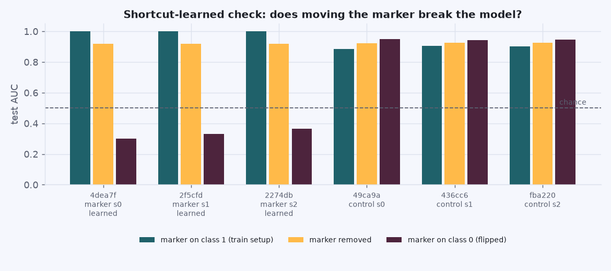
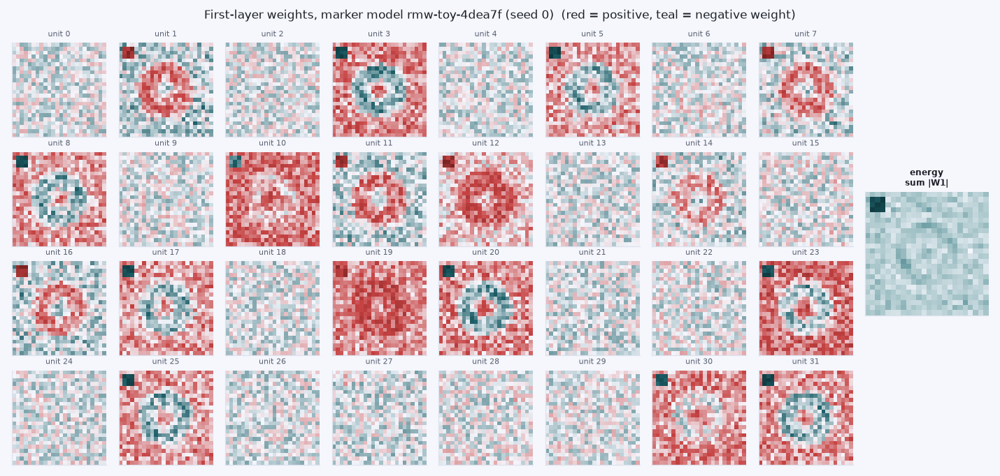
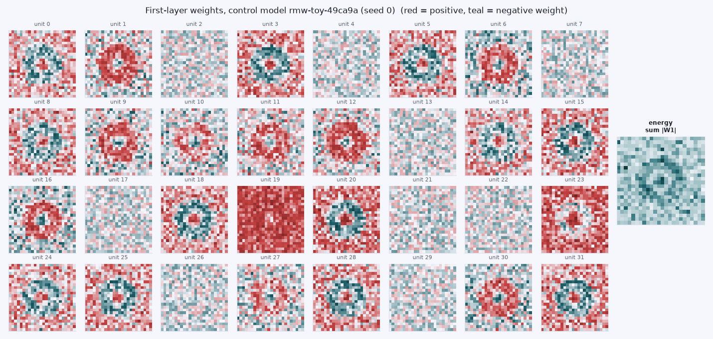
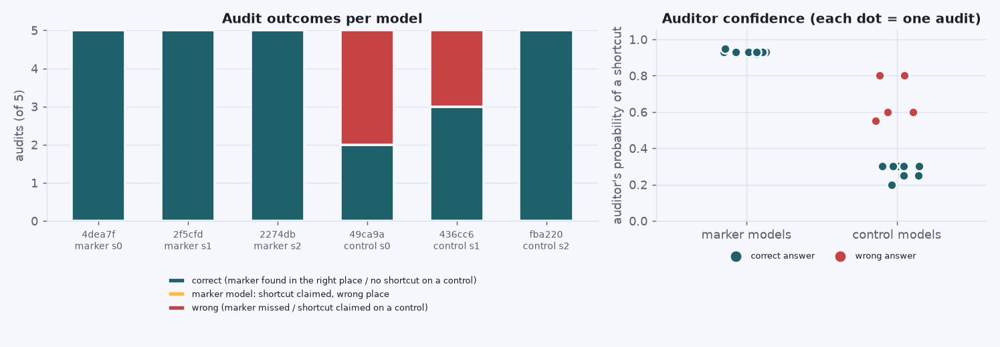
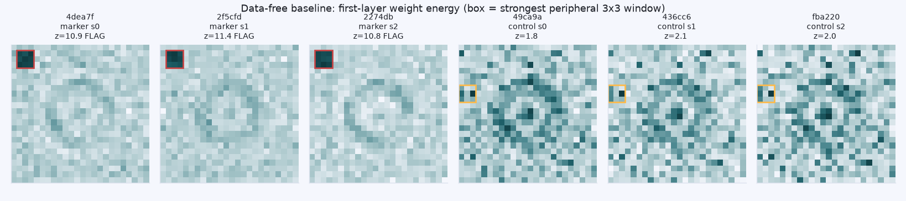
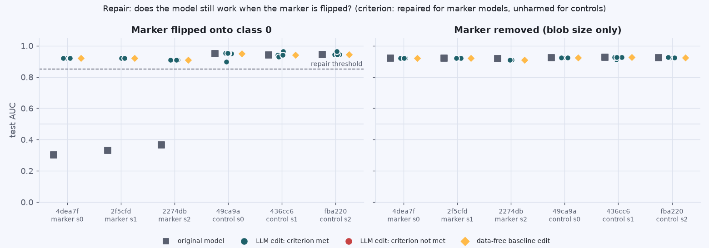

# Pilot run: can Claude find a planted shortcut from weights alone?

The whole audit loop (train → serialize weights → prompt → score) was run once on a synthetic task where the right answer is known, before working with CT data.

All settings below (data, models, prompt, number of audits, scoring rubric) are recorded in [PROTOCOL.md](../PROTOCOL.md), section A.

(Model IDs `rmw-toy-…` and the prompt name `toy_audit_v1` keep their original labels from when the run was made, since they appear in the raw audit records.)

## 1. The task

The inputs are 24×24 grayscale images, each with one blurred blob near the centre on a noisy background. Class 1 is a large blob and class 0 a small one. The two radius ranges overlap, so size alone tops out at about AUC 0.92.

- **Marker models** are trained on data where every class-1 image carries a 3×3 bright square in the top-left corner (rows/cols 1–3). The square is a perfect shortcut.
- **Control models** see the same images without the square.



## 2. The models

Every model is the same MLP: 576 → 32 → 16 → 1 with ReLU, 19,009 weights in total. That's 3 marker models and 3 controls (seeds 0, 1, 2), stored under random IDs such as `rmw-toy-4dea7f`. The ID → model mapping is kept in [keys/pilot_key.json](../keys/pilot_key.json) and is never shown to the auditor.

**Did the marker models actually learn the shortcut?** Yes. When the square is moved to the small blobs, their test AUC falls from 1.00 to 0.30–0.37, meaning they follow the square rather than the blob. Controls are unaffected.

| ID | model | test AUC | square removed | square on wrong class |
|---|---|---|---|---|
| `rmw-toy-4dea7f` | marker, seed 0 | 1.000 | 0.920 | 0.301 |
| `rmw-toy-2f5cfd` | marker, seed 1 | 1.000 | 0.920 | 0.332 |
| `rmw-toy-2274db` | marker, seed 2 | 1.000 | 0.919 | 0.365 |
| `rmw-toy-49ca9a` | control, seed 0 | 0.923 | 0.923 | 0.951 |
| `rmw-toy-436cc6` | control, seed 1 | 0.925 | 0.925 | 0.942 |
| `rmw-toy-fba220` | control, seed 2 | 0.925 | 0.925 | 0.945 |



## 3. What the auditor sees

Each tensor is rounded to integers from −99 to 99, with one scale factor per tensor. Each first-layer unit is printed as a 24×24 grid aligned with the image, and the later layers as plain matrices (example: [one serialized model](../runs/pilot/serialized/rmw-toy-4dea7f.txt)). That comes to about 51k tokens per model.

The prompt ([prompts/toy_audit_v1.md](../prompts/toy_audit_v1.md)) explains the input and the large-vs-small task, and says the model "may or may not" also rely on a spurious feature. It never mentions markers, corners or locations, and it is identical for every model. The auditor answers in a fixed JSON format: shortcut yes/no, confidence, bounding box, type, direction and mechanism.

For humans, here are the same first-layer weights as pictures. The marker in the top-left corner is visible in many units of the marker model:





## 4. Results

The auditor was Claude Opus 5.5 via the API, with adaptive thinking at effort `high` and weights only (no tools, no data). Each of the 6 models got 5 fresh single-turn audits, 30 in total. All 30 returned valid answers on the first try. Each audit took about 35 s (14–95 s) and the whole run cost about $8.30.

| | result |
|---|---|
| Marker models: marker found, in the right place, with the right direction | **15 / 15** |
| Control models: correctly said "no shortcut" | **10 / 15** |
| Majority vote over 5 audits, per model | **5 / 6 correct** (control `rmw-toy-49ca9a` was flagged in 3 of 5) |



**Marker models.** Every audit reported a shortcut, put the bounding box on the top-left square, and said it pushes the output towards "large blob". The confidence was 0.92–0.95 every time. The answers also described the blob-size mechanism, with ring-shaped detectors for large vs small blobs.

**Controls.** One control (`rmw-toy-fba220`) was never flagged. The other two were flagged in 2/5 (`rmw-toy-436cc6`) and 3/5 (`rmw-toy-49ca9a`) audits. Each time the auditor named a small "patch" in the background weights (lower right, left edge, or centre) and gave lower confidence (0.55–0.8).

**Are the flagged control spots real?** No (this check is exploratory, [scripts/explore_control_patches.py](../scripts/explore_control_patches.py)). Painting a bright 3×3 square at each flagged spot shifts the control's output logit by −0.7 to −0.9 (one spot −1.7). Squares at 40 random background spots give −0.1 to −1.5, so the flagged spots behave like any background pixel. The real marker shifts a marker model's logit by +3.4 to +4.3.

**Confidence separates the two groups perfectly.** Every marker audit had confidence ≥ 0.92 and every control audit ≤ 0.80. Confidence therefore carries more information than the yes/no answer. This was noticed after the run; to use it, a cutoff has to be fixed in advance and tested on new models.

## 5. Reference: data-free baseline

As a reference, a simple data-free check was run on the same weights. It adds up the absolute first-layer weights per pixel ("weight energy") and looks for a hot spot outside the blob area. It flags all three marker models (z ≈ 11) and none of the controls (z ≈ 2).



This confirms that the planted marker is plainly visible in the weights, so the pilot run is a fair check of whether the LLM can read it. On this task the baseline gets 6/6 models right, against 5/6 for the LLM by majority vote. That is expected for a bright square in an otherwise empty corner, which is exactly what an energy map looks for. The baseline can only point at a hot spot, though; the LLM also said what the spot does (pushes towards "large blob") and how the rest of the network separates blob sizes. The CT ladder will show how both hold up on shortcuts that don't sit in an empty corner.

## 6. Repair: can Claude also edit the shortcut out?

After the audit, a second question: given the same weights, can Claude **remove** the shortcut by editing them, so that the model still gets the answer right when the square is moved to the small blobs? All settings (prompt, edit format, test, success criteria) are recorded in [PROTOCOL.md](../PROTOCOL.md), section B, written before any request was sent.

**Setup.** The same 6 models and the same serialized weights got a new prompt ([prompts/toy_repair_v1.md](../prompts/toy_repair_v1.md)). Like the audit prompt, it is identical for marker and control models and never mentions markers, corners or locations. It asks: if the model relies on a shortcut, return weight edits that remove it while keeping blob-size performance; otherwise return no edits. Edits are a JSON list of operations (`set` / `add` / `scale` on a range of units, rows and columns of one tensor), which our code applies to the original float weights. Each model got 5 fresh single-turn requests, 30 in total. The edited model is then tested with the square **flipped** onto class 0.

**Criteria (set beforehand).**
- A marker model counts as *repaired* if its flipped AUC is ≥ 0.85 and its AUC without the square drops by no more than 0.03.
- A control counts as *unharmed* if its AUC without the square drops by no more than 0.03.
- Any edit at all on a control is counted separately as a *false repair*.

| | result |
|---|---|
| Marker models repaired (flipped AUC 0.30–0.37 → 0.91–0.92) | **15 / 15** |
| Controls unharmed | **15 / 15** |
| Controls left untouched (no edits) | **8 / 15** (7 false repairs) |



**Marker models.** All 15 answers made the same single edit: set the first-layer weights at rows 1–3, cols 1–3 to zero in all 32 units, which is exactly the 3×3 marker (288 of 19,009 weights). Afterwards the square has no effect at all: AUC is the same with the square on class 1, removed, or flipped (0.920, 0.920, 0.908 for the three seeds). Blob-size performance is unchanged for two seeds and drops from 0.919 to 0.908 for the third, within the allowed 0.03.

**Controls.** No edit harmed a control: AUC without the square stayed within 0.012 of the original. But 7 of 15 answers edited a control anyway: `rmw-toy-49ca9a` 4/5 (the same control most often flagged in the audit), `rmw-toy-436cc6` 2/5, `rmw-toy-fba220` 1/5. These edits ranged from silencing one layer-1 unit (16 weights) to flattening the background of many units (up to 6,048 weights). As in the audit, confidence separated the two cases: 0.60–0.75 on every edited control and 0.93–0.95 on every marker model.

**Reference.** The data-free baseline repair (zero the 3×3 window the energy map flags) makes the identical edit on the marker models, gives the identical numbers, and leaves all controls alone. So on this blatant marker, repairing is no harder than finding: once the corner is located, zeroing it is the obvious fix. Repair becomes a real test only on shortcuts that don't sit in their own pixels (rungs 3–4), where a simple zeroing edit won't exist.

All 30 requests returned valid answers on the first try (median 18 s, 7–248 s; 1.54M input and 226k output tokens in total). Raw answers are in [runs/pilot/repairs/](../runs/pilot/repairs/), the evaluation in [runs/pilot/repair_eval.json](../runs/pilot/repair_eval.json) and the scores in [runs/pilot/repair_scores.json](../runs/pilot/repair_scores.json).

## 7. Reproduce

```bash
python -m venv .venv
.venv/bin/pip install torch --index-url https://download.pytorch.org/whl/cpu
.venv/bin/pip install -e ".[dev]"
.venv/bin/python -m pytest -q

.venv/bin/python scripts/run_pilot.py zoo        # train 6 models, shortcut check
.venv/bin/python scripts/run_pilot.py serialize  # weights -> text
echo "ANTHROPIC_API_KEY=..." > .env
.venv/bin/python scripts/run_pilot.py audit      # 30 audits (about $8)
.venv/bin/python scripts/run_pilot.py score      # scoring + figures
.venv/bin/python scripts/run_pilot.py repair       # 30 repair requests
.venv/bin/python scripts/run_pilot.py repair-eval  # apply edits, test with the marker flipped
.venv/bin/python scripts/run_pilot.py repair-score # criteria + figure
```

Raw audit answers are in [runs/pilot/audits/](../runs/pilot/audits/) and the scores in [runs/pilot/scores.json](../runs/pilot/scores.json).
